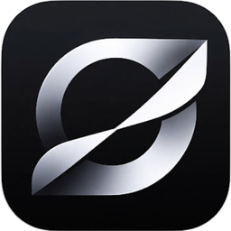

  
  <h2 align="center">The Open Browser Company</h2>
  
Independent software company building open-source browsers and tools for a better web.

  

    <a href="https://github.com/OpenBrowserCompany/CATOPTRIC"><strong>Explore the browser</strong></a>
    &nbsp;·&nbsp;
    <a href="https://github.com/orgs/OpenBrowserCompany/repositories">All repositories</a>
  

INDEPENDENT &nbsp;·&nbsp; OPEN SOURCE &nbsp;·&nbsp; BUILT FOR THE WEB

---

## What we build

<table>
  <tr>
    <td width="33%" valign="top">
      <h3>Browsers</h3>
      
A Chromium-based browser for macOS, shaped around a sidebar-first interface and a calmer relationship with the web.

    </td>
    <td width="33%" valign="top">
      <h3>Tools</h3>
      
Focused utilities and developer tooling that support the browser and the people building on the open web.

    </td>
    <td width="33%" valign="top">
      <h3>Open foundations</h3>
      
Public code, readable documentation, and contributions back to the projects we depend on.

    </td>
  </tr>
</table>

## Open source, by default

The browser is too important to be a black box. We work in public: the code, the issues, the trade-offs, and the rough edges. We would rather ship a smaller thing in the open than a polished thing behind a wall.

We contribute upstream where we can, keep documentation close to the code, and treat every repository as an invitation rather than a storefront. Each project carries its own license.

## Projects

<table>
  <tr>
    <td width="88" align="center" valign="top">
      
    </td>
    <td valign="top">
      <h3>CATOPTRIC</h3>
      
A free, Chromium-based browser for macOS with a sidebar-first interface. The source is public.

      

        <a href="https://github.com/OpenBrowserCompany/CATOPTRIC">View the repository →</a>
         Chromium &nbsp;·&nbsp; macOS &nbsp;·&nbsp; TypeScript
      

    </td>
  </tr>
</table>

Supporting repositories and work in progress live in [the organization's repositories](https://github.com/orgs/OpenBrowserCompany/repositories).

## Build with us

We are early, and the work is out in the open. If you care about browsers, the web platform, or the craft of small software, there is a place to start.

  <a href="../CONTRIBUTING.md">Contributing</a>
  &nbsp;·&nbsp;
  <a href="../CODE_OF_CONDUCT.md">Code of conduct</a>
  &nbsp;·&nbsp;
  <a href="../SECURITY.md">Security</a>
  &nbsp;·&nbsp;
  <a href="../SUPPORT.md">Support</a>

---

  <picture>
    <source media="(prefers-color-scheme: dark)" srcset="../assets/branding/watermark/watermark-light-128.png">
    
  </picture>
   
  <strong>The Open Browser Company</strong> Independent. Open source. Built for the web.

